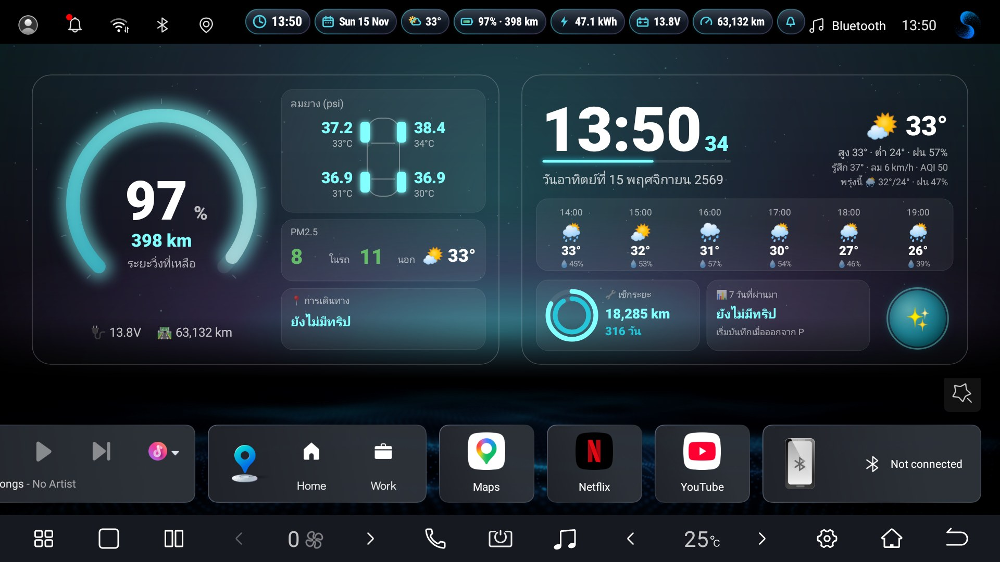
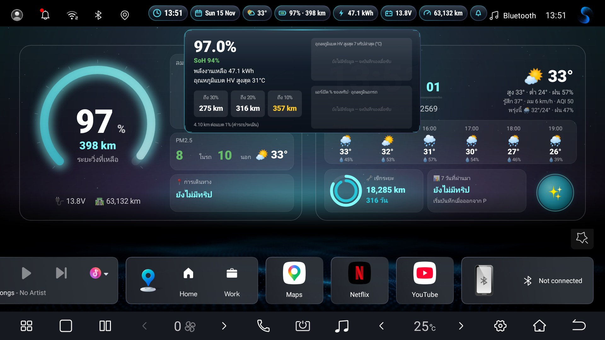
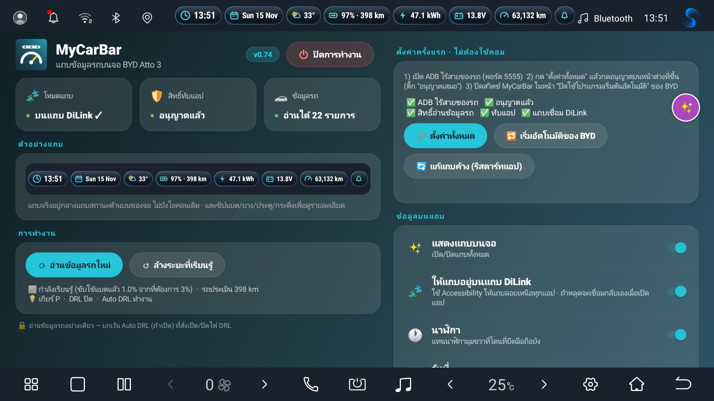

# IconDeck — แถบข้อมูลรถสำหรับ BYD Atto 3

แถบข้อมูลรถบนจอ DiLink (BYD Atto 3, DiLink 3 / Android 10) พร้อมแดชบอร์ดหน้า Home, การ์ดเตือน, Telegram และผู้ช่วย Gemini
**ติดตั้ง ตั้งค่า และใช้งานได้บนจอรถอย่างเดียว ไม่ต้องใช้คอมพิวเตอร์**

> **อ่านข้อมูลรถอย่างเดียว** — ยกเว้น *Auto DRL* (ปิดไว้เป็นค่าเริ่มต้น) ที่สั่งเปิด/ปิดไฟ DRL เท่านั้น
> ไม่ใช่แอปของ BYD · ใช้ด้วยความรับผิดชอบของผู้ใช้เอง

## ภาพหน้าจอ


| แตะชิปแบต: SoH · kWh · ระยะถึง 30/20/10 % | หน้าตั้งค่าในแอป (ตั้งค่าครั้งแรกได้บนจอรถ) |
|---|---|
|  |  |

## ความสามารถหลัก
- แถบบนจอ: นาฬิกา วันที่ อากาศ แบต/ระยะ kWh 12V ลมยาง PM2.5 เลขไมล์ เช็คระยะ การชาร์จ (kW) — แตะชิปเพื่อดูรายละเอียด
- แดชบอร์ดหน้า Home (แนวนอน/แนวตั้ง) · การ์ดภาพรถเมื่อประตู/กระจก/ฝากระโปรงเปิด · เตือนลมยาง
- แผงแบต: SoH, kWh, อุณหภูมิแบต HV, ระยะถึง 30/20/10 %
- พื้นหลัง "ดำหรู" (เลือกเปิดได้): ดำลึก แสงเรืองและดาวจาง ๆ เปลี่ยนสีตามธีม 5 สี · มีปุ่มคืนภาพพื้นหลังของ BYD
- **บันทึกทริปอัตโนมัติ:** ระยะทาง เวลา % แบต kWh kWh/100km — บันทึกได้แม้ดับรถทันทีหลังจอด ·
  แวะพักสั้น ๆ หรือแวะชาร์จระหว่างทางนับเป็นทริปเดียว · ถึงบ้านแล้วจบทริป (แอปเรียนรู้บ้านเองได้หลายที่ หรือตั้งเอง) ·
  **สถานที่ประจำ** (ที่ทำงาน โรงเรียน ฯลฯ) — ทริปมีชื่อ เช่น "🏠 บ้าน → 🏢 ที่ทำงาน" และสรุปรายเดือนแยกตามสถานที่ ·
  ทริปที่กินไฟสูงกว่าปกติจะบอกสาเหตุ (ขับเร็ว อากาศร้อน/แอร์ ทริปสั้น รถติด)
- **แจ้งเตือนทาง Telegram:** การชาร์จ · จอดที่บ้านแล้วแบตต่ำ (เตือนเสียบชาร์จ) · ยางรั่วซึม (ล้อหนึ่งลมลดลงเรื่อย ๆ) ·
  แบต 12V ต่ำ · รถวิ่งตอนแอปไม่ได้ทำงาน · รายงานรายสัปดาห์/รายเดือน (ค่าไฟ ฿/km)
- Telegram: ส่งลิงก์ YouTube/Maps มาเปิดบนจอรถ, /status /where /charges /soh /trips /log ·
  **/backup /restore** สำรองและกู้คืนข้อมูล · **/export** ไฟล์ CSV ทริปและการชาร์จ · **/place /places** สถานที่ประจำ
- ผู้ช่วย Gemini (ใช้ API key ของคุณเอง), ปุ่มบนพวงมาลัยเปิดผู้ช่วยได้
- แถบกลับมาเองหลังดับ/ติดเครื่อง · คอยเปิด ADB ไร้สายให้อัตโนมัติถ้าถูกปิด (กันถูกล็อกออกจากรถ)

## ขั้นตอน (ทำบนจอรถทั้งหมด)

### 1) เปิด ADB ไร้สายของรถ (ครั้งเดียว)
แอปใช้ ADB ของจอรถเองเพื่อให้สิทธิ์และเชื่อมแถบ — ต้องเปิด **ADB ไร้สาย พอร์ต 5555** บนจอรถ
(เปิดจากโหมดนักพัฒนา/โหมดวิศวกรของ DiLink หรือแอปช่วยเปิด ADB ที่ใช้กันในกลุ่มผู้ใช้ BYD)

### 2) ติดตั้งแอป
1. เปิดเบราว์เซอร์บนจอรถ ไปที่ `github.com/samrid/icondeck-releases` → **Releases** → ดาวน์โหลด `IconDeck-vX.Y.apk`
   (หรือคัดลอกไฟล์ใส่ USB แล้วเปิดด้วยตัวจัดการไฟล์)
2. แตะไฟล์ → ติดตั้ง (ถ้าถาม ให้อนุญาตการติดตั้งจากแหล่งนี้)

### 3) ตั้งค่าครั้งแรก — กดปุ่มเดียว
1. เปิดแอป **IconDeck** → การ์ด **"ตั้งค่าครั้งแรก · ไม่ต้องใช้คอม"** → กด **"🔧 ตั้งค่าทั้งหมด"**
2. จะมีหน้าต่าง **"อนุญาตการแก้จุดบกพร่อง USB หรือไม่"** ขึ้นบนจอ → ติ๊ก **"อนุญาตจากคอมพิวเตอร์นี้เสมอ"** → กด **อนุญาต**
3. แอปจะให้สิทธิ์ทั้งหมด ลงทะเบียนแถบกับ DiLink และเปิดการอ่านการแจ้งเตือนให้เอง — รายการในการ์ดจะเป็น ✅

### 4) ให้แถบเริ่มเองหลังติดเครื่อง
กด **"🔁 เริ่มอัตโนมัติของ BYD"** (หรือ ตั้งค่ารถ → จัดการแอป → "ปิดใช้โปรแกรมเริ่มต้นอัตโนมัติ")
→ สวิตช์ของ **IconDeck ต้อง "ปิด" (สีเทา)** (สวิตช์เปิด = ห้ามเริ่มอัตโนมัติ)
BYD จะเปิดสวิตช์นี้คืนทุกครั้งที่อัปเดตแอป — หลังอัปเดตจะมีการ์ดสีเหลืองบนหน้า Home ให้แตะไปปิด

### 5) ตั้งค่าอื่น ๆ ในแอป
- **ขนาดแบต:** "ขนาดแบต" (49.92 หรือ 60.48 kWh) — ใช้คำนวณ kWh ทริปและค่าไฟ
- **Telegram:** สร้างบอทกับ @BotFather → ใส่ token → กด "จับคู่" → ส่ง `/start` หาบอทภายใน 2 นาที
- **Gemini:** ส่ง `/setkey <API key>` หาบอท (ข้อความจะถูกลบทันที) — ค่าใช้จ่ายเข้าบัญชี Google ของคุณเอง
- **ปุ่มพวงมาลัย:** ผู้ช่วย Gemini → "ตั้งปุ่มใหม่" แล้วกดปุ่มบนพวงมาลัยภายใน 15 วินาที
- **ธีมสี / ตำแหน่งแดชบอร์ด / ชิปที่แสดง:** ในหน้าตั้งค่า
- **บ้าน (สำหรับแยกทริปและเตือนเสียบชาร์จ):** แอปเรียนรู้เองจากที่จอดข้ามคืนที่เดิม 2 คืน (มีบ้านได้หลายที่)
  หรือกด "📍 เพิ่มตำแหน่งนี้เป็นบ้าน" ตอนจอดอยู่บ้าน · ต้องเปิด GPS ให้แอป ("ใช้ GPS")
- **สถานที่ประจำ:** แอปเรียนรู้เองจากที่จอดกลางวันนาน ๆ (4 ชม. ขึ้นไป) ที่เดิม 3 วัน — ตั้งชื่อให้ว่า "ที่ทำงาน" ·
  หรือจอดอยู่ที่นั่นแล้วกด "🏢 บันทึกเป็นที่ทำงาน" / "🏫 บันทึกเป็นโรงเรียน" · ชื่ออื่นส่ง `/place ชื่อ` หาบอท ·
  ถึงสถานที่ประจำแล้วจบทริปเหมือนบ้าน · ดูสถิติเดือนนี้ด้วย `/places`
- **เกณฑ์รวมทริป:** "จอดเฉยๆ ไม่เกิน" (ค่าเริ่มต้น 30 นาที) และ "จอดชาร์จไม่เกิน" (2 ชม.) ในการ์ดทริป
- **เตือนเสียบชาร์จ:** "จอดที่บ้านแล้วเตือนเสียบชาร์จถ้าแบตต่ำกว่า" (ค่าเริ่มต้น 30 %, ปิดได้)

## สำรอง / ย้ายข้อมูล
- แอปส่งไฟล์สำรอง (ทริป การชาร์จ SoH ลมยาง บ้าน/สถานที่ประจำ และค่าตั้งบางส่วน) เข้าแชท Telegram ทุกสัปดาห์ · สั่งทันทีด้วย `/backup`
- ไฟล์สำรอง **ไม่มี** token ของบอทหรือ Gemini key
- กู้คืน (เช่น หลังติดตั้งแอปใหม่): ตอบกลับ (reply) ไฟล์สำรองในแชทด้วย `/restore` — ข้อมูลที่มีอยู่แล้วบนรถจะไม่ถูกลบหรือทับ

## อัปเดต
ในแอป: **อัปเดตแอป → "ตรวจอัปเดต" → "ติดตั้ง"** · จากนั้นแตะการ์ดสีเหลืองบนหน้า Home เพื่อปิดสวิตช์เริ่มอัตโนมัติอีกครั้ง

## แก้ปัญหา
- แถบไม่ขึ้นหลังติดเครื่อง → รอประมาณ 15 วินาที แอปจะเชื่อมใหม่เอง (ถ้าตั้งค่าครั้งแรกแล้ว) · ถ้ายังไม่ขึ้น เปิดแอป IconDeck
- แถบหายหลังกด "ปิดแอปทั้งหมด" ของ BYD → เปิดแอป IconDeck อีกครั้ง
- ปิดการทำงานทั้งหมดชั่วคราว → ปุ่ม **"⏻ ปิดการทำงาน"** มุมขวาบนของหน้าตั้งค่า (กดอีกครั้งเพื่อเปิด)
- ดูบันทึกการทำงาน → Telegram `/log`
- **ADB ไร้สายถูกปิดเอง** → แอปจะเปิดกลับให้อัตโนมัติ (ตั้งค่า → "🔌 คอยเปิด ADB ไร้สายให้") และแจ้งทาง Telegram ·
  ถ้า ADB ถูกปิดสนิท (เช่น หลัง factory reset) แอปเปิดกลับเองไม่ได้ ต้องเปิดจากเมนูวิศวกรรมบนจอรถก่อน

## ความปลอดภัย
- แอปถือกุญแจ ADB ของตัวเอง (เก็บในพื้นที่ส่วนตัวของแอป) และสั่งได้เฉพาะชุดคำสั่งที่ฝังไว้: ให้สิทธิ์ของแอปเอง,
  ลงทะเบียนแถบ/การแจ้งเตือนของแอปเอง, และรีสตาร์ทตัวเองเมื่อแถบค้าง — ไม่มีช่องให้สั่งคำสั่งอื่น
- ยกเลิกสิทธิ์ ADB ของแอปได้ที่ ตั้งค่า → ตัวเลือกสำหรับนักพัฒนา → **เพิกถอนการให้สิทธิ์แก้จุดบกพร่อง USB**
- ตรวจไฟล์แท้: ลายเซ็น `CN=MyCarBar`, SHA-256 `3ee9eeb352122ad54587e9c624a6d4823e333f72d74e4e67515cfa4e8ff0bdd1`

## ถอนการติดตั้ง
ตั้งค่ารถ → จัดการแอป → IconDeck → ถอนการติดตั้ง (หรือกด "ปิดการทำงาน" ก่อน เพื่อคืนสถานะ Accessibility ให้เรียบร้อย)

---
### ภาคผนวก: ติดตั้งด้วยคอมพิวเตอร์ (ถ้าต้องการ)
```
adb connect <IP รถ>:5555
adb install -r IconDeck-vX.Y.apk
```
จากนั้นเปิดแอปแล้วทำข้อ 3–5 ตามปกติ
